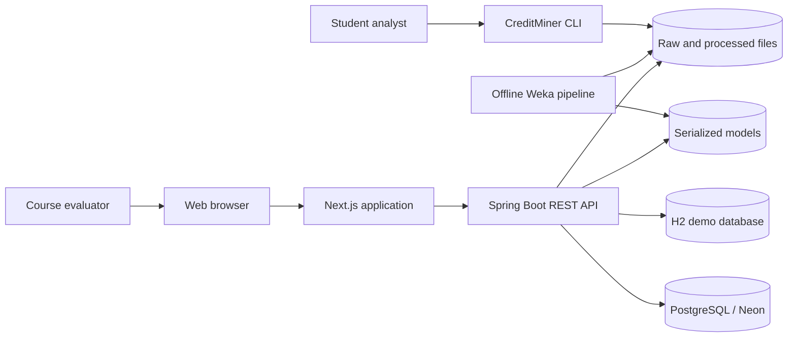
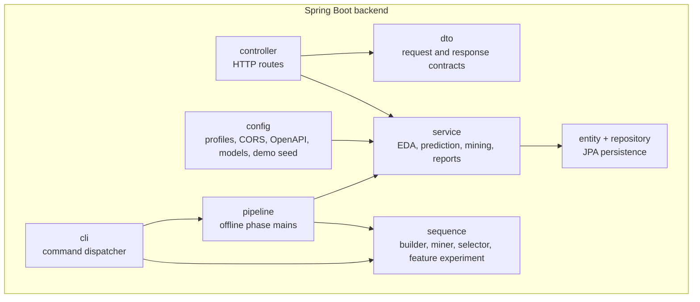

# CreditMiner technical architecture

## 1. Purpose and context

CreditMiner is a full-stack data mining system for credit-card default prediction and repayment-sequence analysis. It uses the UCI Default of Credit Card Clients dataset, Weka models, Apriori rules, K-means clustering, and GSP sequence mining.

The design separates two workloads:

1. An offline pipeline prepares data, evaluates algorithms, and writes reproducible artifacts.
2. An online application reads those artifacts, serves REST data, runs classifier inference, and presents the evidence in a browser.

This boundary keeps model training out of request handling. It also lets the demo run without an external database.

## 2. System context



The main users are course evaluators, project team members, and demo operators. No external customer system is integrated.

## 3. Containers

| Container | Technology | Responsibility | Default port |
| --- | --- | --- | ---: |
| Web | Next.js 14.2 App Router, React, TypeScript, Tailwind, shadcn, Recharts, TanStack Query, zod | Pages, charts, tables, form validation, API calls, web report, and print report | 3000 by default; 3001 requires adding its origin to `creditminer.cors.allowed-origins` |
| API | Java 17, Spring Boot 3.2.5, Weka 3.8.6 | REST controllers, artifact-backed services, database access, and model inference | 8080 for development; 8091 for the local demo |
| Offline pipeline | Java 17, Maven, Weka, GSP package 1.0.1 | Data preparation, evaluation, clustering, rule mining, sequence mining, and artifact generation | Not applicable |
| CLI | Shaded Java JAR | Reusable preprocessing, training, prediction, evaluation, and sequence commands | Not applicable |
| Data store | H2 or PostgreSQL | Customers, clusters, rules, insights, and prediction logs | In process for H2; provider-defined for PostgreSQL |
| Artifact store | Local filesystem | ARFF, JSON, CSV, Weka models, cluster support files, and rule output | Not applicable |

## 4. Component view



### 4.1 Package responsibilities

| Package | Responsibility |
| --- | --- |
| `cli` | Parses commands and paths. Runs `preprocess`, `train`, `predict`, `evaluate`, and `sequence` without starting Spring. |
| `pipeline` | Provides the eight artifact phase entry points plus explicit database utilities. Pipeline phase mains operate on local files. |
| `sequence` | Builds six-month repayment sequences, runs GSP, selects discriminative patterns, and tests sequence features inside each fold. |
| `service` | Implements preprocessing, features, classification, clustering, EDA, rules, anomalies, sequence reads, reporting, prediction input building, and seeding. |
| `controller` | Maps all HTTP routes under `/api` and delegates work to services. |
| `dto` | Defines validated request data and stable JSON response shapes. |
| `entity` and `repository` | Define the relational records and Spring Data access layer. |
| `config` | Loads models, configures CORS and OpenAPI, selects profile settings, and starts the H2 demo seed. |

### 4.2 Frontend components

The `web/src/app` directory owns routes. Feature components and chart wrappers live under `web/src/components`. Hooks call the typed client in `web/src/lib`. zod schemas validate API responses before the pages use them.

The browser routes are `/`, `/eda`, `/clusters`, `/customers`, `/rules`, `/insights`, `/predict`, `/pipeline`, `/sequences`, `/mining-report`, and `/report/paper`.

## 5. Offline data flow

```mermaid
flowchart LR
    Raw[default_credit_card_clients.csv] --> P1[Phase1Report]
    P1 -->|phase1_raw.arff| P2[Phase2Report]
    P1 -.->|phase1_describe.json| Phase1Evidence[Generated Phase 1 and mining-report evidence]
    P2 -->|clean.arff\nphase2 reports| P3[Phase3Report]
    P3 -->|enriched.arff| P5[Phase5Pipeline]
    P5 -->|train.arff + test.arff\nclassifier models\nevaluation + importance| P6[Phase6Pipeline]
    P6 -->|k-means + PCA\nclusters + anomalies| P7[Phase7Pipeline]
    P7 -->|clean_assoc.arff\nrules.json| Facts[InsightFactsReport]
    Facts -->|phase9_insight_facts.json| P10[Phase10Pipeline]
    P10 -->|phase10_sequences.json\nsequence ARFF files| Consumers[API, H2 seed, reports]
```



### 5.1 Transformation rules

- Phase 1 converts the 30,000 source records to ARFF and writes descriptive statistics.
- Phase 1 maps categorical codes to labels and renames columns. Phase 2 removes 35 duplicates, flags 1.5-IQR outliers, and keeps negative bill balances.
- Phase 3 adds seven engineered features and writes `enriched.arff`.
- Phase 5 creates `train.arff` and `test.arff` with a seed-42 stratified 80/20 split, then evaluates ten classifier variants with 10-fold cross-validation and the holdout set.
- Phase 6 trains K-means with `k=2`, writes a PCA projection, and derives centroid-distance anomaly evidence.
- Phase 7 runs separate Apriori passes and writes 42 default rules plus 50 non-default rules.
- The insight report combines traceable facts from the earlier artifacts.
- Phase 10 mines six-month repayment sequences at exact support thresholds and runs a fold-local feature experiment.

## 6. Data model

The online relational model has five main concepts.

| Concept | Purpose | Key relationships |
| --- | --- | --- |
| `customers` | Raw UCI fields, engineered fields, labels, cluster assignment, and anomaly flags | Each customer can reference one cluster. |
| `clusters` | Cluster size, default rate, persona, and centroid data | One cluster groups many customers. |
| `rules` | Apriori antecedent, consequent, support, confidence, lift, and category | Rules describe either default or non-default outcomes. |
| `insights` | Curated finding, evidence, and recommendation content | Read by insight and report services. |
| `predictions` | Inputs and results logged by the prediction workflow | Independent records for inference review. |

H2 creates this model for each demo process. PostgreSQL stores the same application concepts for development and hosted use. Hibernate uses `ddl-auto: validate` for `dev` and `prod`; the `demo` profile uses `create` against its in-memory database.

## 7. Artifact contracts

Artifacts are versioned by file name and JSON structure. Services read them from configurable paths.

| Artifact | Produced by | Primary consumers and endpoints |
| --- | --- | --- |
| `data/processed/phase1_describe.json` | `Phase1Report` | Generated Phase 1 evidence and mining-report evidence |
| `data/processed/enriched.arff` | `Phase3Report` | Primary `DescribeCacheService` input; Phase 5–10 inputs; demo seeding; overview, customer, EDA, and report data |
| `data/processed/train.arff`, `test.arff` | `Phase5Pipeline` | Classification evaluation and Phase 10 fold-local experiment |
| `data/processed/phase5_evaluation.json` | `Phase5Pipeline` | `GET /api/mining-report`; model evidence views |
| `data/processed/phase5_feature_importance.json` | `Phase5Pipeline` | Mining report and insight-fact generation |
| `models/DECISIONTREE.model` through `models/RANDOMFOREST_COST.model` | `Phase5Pipeline` | CLI; configured online classifier uses `RANDOMFOREST_COST.model` by default |
| `models/best.json` | `Phase5Pipeline` | Records the model-selection decision |
| `data/processed/phase6_clusters.json` | `Phase6Pipeline` | Demo/database seed; `GET /api/clusters`; mining report |
| `data/processed/phase6_pca_2d.json` | `Phase6Pipeline` | `GET /api/eda/pca-2d`; cluster visualization |
| `data/processed/phase6_anomalies.json` | `Phase6Pipeline` | `GET /api/anomalies`; mining report |
| `models/kmeans.model` and support models | `Phase6Pipeline` | Cluster assignment and demo/database seed support |
| `models/rules.json` | `Phase7Pipeline` | `GET /api/rules`; demo/database seed; mining report; insight facts |
| `data/processed/phase9_insight_facts.json` | `InsightFactsReport` | Evidence for insights and report content |
| `data/processed/phase10_sequences.json` | `Phase10Pipeline` | `GET /api/sequences`; sequence page; mining report |

Database-backed routes include overview, customers, clusters, rules, insights, anomalies, and prediction logs. Artifact-backed services provide describe data, PCA, evaluation evidence, and sequence results. The demo initializer combines both sources by loading artifacts into H2.

`GET /api/eda/describe` is computed by `DescribeCacheService`. It reads the first available source in this order: `enriched.arff`, `clean.arff`, `phase1_raw.arff`, then the raw CSV. It does not read `phase1_describe.json`.

## 8. Online request flow

1. TanStack Query calls the typed API client.
2. The API client requests a route under `/api`.
3. A controller validates query or body input and calls a service.
4. The service reads a repository, a cached artifact, or an in-memory Weka model.
5. The controller returns lower-camel-case JSON.
6. The web client validates the response with zod before rendering it.

Prediction is the only classifier inference route. `POST /api/predict` builds the same raw and engineered feature order used in training, applies the configured model, and returns the default probability, label, risk tier, cluster information, feature explanations, recommendation, and model name.

## 9. Build and packaging

Maven produces two Java deliverables from `backend/pom.xml`:

| Deliverable | Build mechanism | Use |
| --- | --- | --- |
| Spring Boot JAR | `spring-boot-maven-plugin` | Start the REST service with its Spring dependencies and profiles. |
| `target/creditminer-cli.jar` | `maven-shade-plugin` | Run the Spring-free CLI with Weka and its dependencies included. |

The web build uses Corepack and pnpm. Next.js creates the production web bundle with `corepack pnpm build`.

The GSP package is declared as version 1.0.1 and is also supported by the local `backend/lib` contents. Weka is version 3.8.6.

## 10. Profiles and configuration

| Profile | Database | Schema behavior | Intended use |
| --- | --- | --- | --- |
| `demo` | H2 in memory | `create`; seed from local data and models | One-command local review on port 8091 |
| `dev` | PostgreSQL | `validate` | Local development on port 8080 |
| `prod` | PostgreSQL, including Neon | `validate` | Hosted API |

Important environment variables include:

- `SPRING_PROFILES_ACTIVE` and `SERVER_PORT`.
- `DATABASE_URL`, `DB_USER`, and `DB_PASSWORD` for PostgreSQL profiles.
- `CM_RAW_CSV`, `CM_PROCESSED_ARFF`, and other `CM_*` artifact-path overrides.
- `CM_MODEL_CLASSIFIER`, `CM_MODEL_CLUSTERER`, and related model-path overrides.
- `CM_FRONTEND_URL` for production CORS configuration.
- `NEXT_PUBLIC_API_URL` for the web client.

The production configuration can import an optional `backend/.env` file as properties. This file is local and git-ignored. Environment variables remain the preferred hosted configuration mechanism.

## 11. Deployment options

### Local academic demo

Run the API with the `demo` profile on 8091 and the web application on 3000. No network database is needed. Startup seeds H2 from local artifacts and can take about 60 seconds on the first load.

### Local development

Run the API with `dev` on 8080 and connect it to a PostgreSQL database. Apply schema work only through an approved database process. Run the web application on 3000 and point `NEXT_PUBLIC_API_URL` at the API. To use port 3001, also add that frontend origin to `creditminer.cors.allowed-origins`.

### Hosted deployment

Deploy the Next.js bundle to a Node-compatible host. Deploy the Spring Boot JAR to a Java 17 host with access to the artifact set and a PostgreSQL or Neon database. Supply all credentials and artifact paths through the host configuration. The repository does not perform an automatic production deployment.

## 12. Quality gates and tests

The backend test suite contains 75 tests. The expected backend gate is:

```bash
cd backend
mvn -B test
```

The frontend gates are:

```bash
cd web
corepack pnpm install --frozen-lockfile
corepack pnpm typecheck
corepack pnpm lint
corepack pnpm build
corepack pnpm test:e2e
```

The E2E suite includes prediction and accessibility coverage. Lighthouse CI is available through `corepack pnpm lhci`. Do not infer a pass result from this document; record the output each time the gates run.

Pipeline quality controls include seed 42, a fixed stratified split, 10-fold cross-validation, holdout evaluation, named model artifacts, recorded timings, and fold-local construction of sequence features.

## 13. Security and operational notes

- Do not store secrets in the repository, documentation, screenshots, logs, or generated samples.
- Keep `backend/.env` local and git-ignored. Store only variable names in documentation.
- The academic application has no authentication layer. Do not expose it as a public service without access controls.
- Restrict CORS to the actual frontend origin in hosted environments.
- Treat seeders, migrations, reset scripts, and database utilities as explicit write operations. Back up data and confirm the target before use.
- Validate request bodies at the controller boundary. Do not trust browser validation alone.
- Keep model and data artifacts from the same pipeline run to prevent schema-order mismatches.
- Preserve the UCI dataset attribution and the GPL 3.0 obligations for Weka and the GSP package.

## 14. Architectural decisions

| Decision | Reason |
| --- | --- |
| Train offline and infer online | Request handling stays predictable and does not retrain models. |
| Keep a file-based artifact contract | Every report claim can trace back to a generated file. |
| Provide an H2 demo profile | Evaluation does not depend on database credentials or network access. |
| Keep PostgreSQL for development and hosted use | The relational API remains representative of a deployed system. |
| Ship a shaded CLI | Data mining tasks can run without Spring or an application server. |
| Validate web responses with zod | Contract drift fails near the client boundary instead of producing silent UI errors. |

## 15. Known boundaries

- Team member details beyond the leader are to be confirmed.
- Instructor confirmation of the final submission form is pending.
- The final submission ZIP has not been produced.
- Authentication, multi-tenant access, and real-time retraining are outside the course scope.

For operator commands, start with [README.md](README.md). For endpoint details, see [docs/API.md](docs/API.md). For phase commands and artifacts, see [docs/PIPELINE.md](docs/PIPELINE.md).
