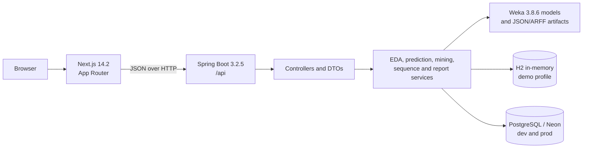
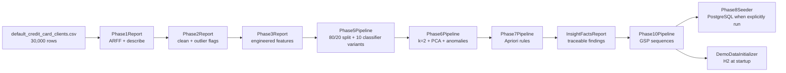

<div align="center">

# CreditMiner

CreditMiner is an end-to-end data mining project for credit-card default prediction. It turns the 30,000-client UCI dataset 350 into reproducible Weka models, descriptive evidence, customer segments, association rules, anomaly signals, and six-month GSP repayment patterns, then presents the results through a Spring Boot API and a Next.js dashboard.

[](https://openjdk.org/)
[](https://www.cs.waikato.ac.nz/ml/weka/)
[](https://spring.io/projects/spring-boot)
[](https://nextjs.org/)
[](https://neon.tech/)
[](LICENSE)

**IT160IU Data Mining · UCI dataset 350 · Weka classification and pattern mining**

</div>

## Table of contents

- [What it does](#what-it-does)
- [Results](#results)
- [Architecture](#architecture)
- [Quick start](#quick-start)
- [Command-line interface](#command-line-interface)
- [Regenerate the artifacts](#regenerate-the-artifacts)
- [Web application and API](#web-application-and-api)
- [Project layout](#project-layout)
- [Dataset and licenses](#dataset-and-licenses)
- [Documentation](#documentation)
- [Team](#team)
- [License](#license)

## What it does

The project implements the four assignment steps as connected modules. Each step leaves inspectable artifacts for the report and user interface.

| Assignment step | CreditMiner module | Main evidence |
| --- | --- | --- |
| Step 1 — understand and prepare the data | `Phase1Report`, `Phase2Report`, `Phase3Report` | Descriptive statistics, cleaned ARFF, outlier flags, and engineered features |
| Step 2 — build and evaluate predictive models | `Phase5Pipeline` | Seed-42 stratified split, ten Weka variants, 10-fold cross-validation, holdout results, timings, feature importance, and serialized models |
| Step 3 — discover structures and patterns | `Phase6Pipeline`, `Phase7Pipeline`, `Phase10Pipeline` | K-means clusters, PCA projection, anomalies, Apriori rules, and GSP repayment sequences |
| Step 4 — explain and deliver the findings | `InsightFactsReport`, Spring API, Next.js dashboard and reports | Traceable facts, interactive views, prediction workflow, STE web report, and print-first paper |

### Data preparation

The source file is `backend/data/raw/default_credit_card_clients.csv`. It contains 30,000 clients from the Default of Credit Card Clients dataset by Yeh and Lien (2009).

Phase 1 maps categorical codes to labels and renames columns. Phase 2 removes 35 duplicate rows, flags 1.5-IQR outliers, and keeps valid negative bill balances. Feature engineering adds:

- `UTILIZATION_1`
- `AVG_UTILIZATION`
- `PAY_RATIO`
- `MONTHS_DELAYED`
- `MAX_DELAY`
- `BILL_TREND`
- `RISK_TIER`

The pipeline uses seed 42 for the stratified 80/20 train and test split.

### Classification

The classification stage evaluates ten Weka variants:

- J48, RandomForest, NaiveBayes, and Logistic baselines.
- SMOTE versions of all four algorithms.
- Cost-sensitive J48 and RandomForest models.

Selection uses 10-fold cross-validation with the positive class `Default=Yes`. The pipeline also records build time, cross-validation time, holdout prediction time, and prediction time per record.

### Pattern discovery

The unsupervised and descriptive stages add several views of risk:

- K-means with `k=2` for customer grouping.
- PCA for a two-dimensional cluster view.
- Centroid distance combined with preprocessing flags for anomaly review.
- Apriori passes for default and non-default association rules.
- GSP over six-month repayment-status sequences.
- A fold-local experiment that tests sequence features without leaking holdout information.

## Results

| Measure | Result |
| --- | ---: |
| Source rows | 30,000 |
| Rows after cleaning | 29,965 |
| Train / test rows | 23,972 / 5,993 |
| Default rate | 22.1% |
| Selected model | RandomForest, cost-sensitive |
| 10-fold CV F1, `Default=Yes` | 0.5263 |
| Holdout F1, `Default=Yes` | 0.5333 |
| Holdout ROC AUC | 0.777 |
| Frequent GSP patterns at support 0.10 | 2,037 default / 1,729 non-default |
| Strongest reported default pattern | `<{PARTIAL}{LATE_2}>`: 48.2% vs 14.1% |

These metrics describe the checked-in generated artifacts. Regenerate all artifacts after a source-data or pipeline change.

## Architecture

CreditMiner separates offline model building from online presentation and inference. The local demo uses H2 and seeds it from generated artifacts. Development and production profiles use PostgreSQL.



The offline pipeline runs from the `backend` directory. Every stage reads the prior artifacts and writes its own evidence.



See [Architecture.md](Architecture.md) for component boundaries, artifact contracts, profiles, packaging, deployment options, and security notes.

## Quick start

### Prerequisites

Install Java 17, Maven, Node.js 20 or later, and Corepack. The generated artifacts in `backend/data/processed` and `backend/models` must be present for the complete demo.

The demo profile does not use PostgreSQL. It creates an H2 database in memory and seeds it from local processed data and model artifacts.

### Windows PowerShell

Open the first terminal in the repository root:

```powershell
Set-Location backend
$env:SPRING_PROFILES_ACTIVE = "demo"
$env:SERVER_PORT = "8091"
mvn spring-boot:run
```

Open a second terminal in the repository root:

```powershell
Set-Location web
$env:NEXT_PUBLIC_API_URL = "http://localhost:8091/api"
corepack pnpm install --frozen-lockfile
corepack pnpm dev --port 3000
```

### Bash

Open the first terminal in the repository root:

```bash
cd backend
SPRING_PROFILES_ACTIVE=demo SERVER_PORT=8091 mvn spring-boot:run
```

Open a second terminal in the repository root:

```bash
cd web
NEXT_PUBLIC_API_URL=http://localhost:8091/api corepack pnpm install --frozen-lockfile
NEXT_PUBLIC_API_URL=http://localhost:8091/api corepack pnpm dev --port 3000
```

Open `http://localhost:3000`. The first backend load can take about 60 seconds while the H2 database is seeded. The local API is at `http://localhost:8091/api`, and Swagger UI is at `http://localhost:8091/swagger-ui.html`.

For PostgreSQL development, use profile `dev` on the default backend port 8080. Use the optional, git-ignored `backend/.env` pattern only with configuration that imports it. Never commit credentials.

## Command-line interface

The Maven build creates the runnable shaded JAR at `backend/target/creditminer-cli.jar`.

| Command | Purpose |
| --- | --- |
| `preprocess` | Convert the source CSV to cleaned and engineered ARFF files and create the split |
| `train` | Train selected classifiers and write models plus evaluation files |
| `predict` | Write row-level predictions from a model and ARFF file |
| `evaluate` | Write aggregate metrics for a model and labeled ARFF file |
| `sequence` | Build repayment sequences and run GSP plus the fold-local experiment |

Build the JAR from the `backend` directory:

```bash
mvn -B package
java -jar target/creditminer-cli.jar --help
```

### Relative-path examples

Run these examples from the repository root:

```bash
java -jar backend/target/creditminer-cli.jar preprocess --input backend/data/raw/default_credit_card_clients.csv --out backend/data/processed --seed 42 --train-ratio 0.8
java -jar backend/target/creditminer-cli.jar train --train backend/data/processed/train.arff --test backend/data/processed/test.arff --out backend/models --algo ALL --variant all --folds 10 --seed 42
java -jar backend/target/creditminer-cli.jar evaluate --model backend/models/RANDOMFOREST_COST.model --test backend/data/processed/test.arff --out backend/data/processed/cli-evaluation.json
java -jar backend/target/creditminer-cli.jar sequence --input backend/data/processed/enriched.arff --train backend/data/processed/train.arff --test backend/data/processed/test.arff --out backend/data/processed --min-support 0.10 --top 10
```

### Absolute-path example on Windows

```powershell
java -jar D:\01_Workspaces\CreditMiner\backend\target\creditminer-cli.jar predict --model D:\01_Workspaces\CreditMiner\backend\models\RANDOMFOREST_COST.model --test D:\01_Workspaces\CreditMiner\backend\data\processed\test.arff --out D:\01_Workspaces\CreditMiner\backend\data\processed\predictions.csv
```

The CLI resolves both relative and absolute paths. Quote a path when it contains spaces.

## Regenerate the artifacts

Use the helper scripts in `scripts/`, or run each phase explicitly. The commands below use Maven offline mode, so all dependencies must already exist in the local Maven cache. Run them from `backend` in this order:

```bash
mvn -o -B compile exec:java -Dexec.mainClass=com.creditminer.pipeline.Phase1Report
mvn -o -B compile exec:java -Dexec.mainClass=com.creditminer.pipeline.Phase2Report
mvn -o -B compile exec:java -Dexec.mainClass=com.creditminer.pipeline.Phase3Report
mvn -o -B compile exec:java -Dexec.mainClass=com.creditminer.pipeline.Phase5Pipeline
mvn -o -B compile exec:java -Dexec.mainClass=com.creditminer.pipeline.Phase6Pipeline
mvn -o -B compile exec:java -Dexec.mainClass=com.creditminer.pipeline.Phase7Pipeline
mvn -o -B compile exec:java -Dexec.mainClass=com.creditminer.pipeline.InsightFactsReport
mvn -o -B compile exec:java -Dexec.mainClass=com.creditminer.pipeline.Phase10Pipeline
```

For PowerShell, quote each property argument, for example:

```powershell
mvn -o -B compile exec:java "-Dexec.mainClass=com.creditminer.pipeline.Phase1Report"
```

See [docs/PIPELINE.md](docs/PIPELINE.md) for inputs, outputs, commands, and recorded run times.

## Web application and API

The Next.js application provides these routes:

| Route | Purpose |
| --- | --- |
| `/` | Overview and key measures |
| `/eda` | Descriptive distributions and relationships |
| `/clusters` | Cluster summaries and PCA projection |
| `/customers` | Filtered customer browser |
| `/rules` | Apriori rule evidence |
| `/insights` | Findings and visual explanations |
| `/predict` | Interactive default prediction |
| `/pipeline` | Assignment and artifact traceability |
| `/sequences` | GSP repayment patterns |
| `/mining-report` | STE-style web report |
| `/report/paper` | Print-first academic report and PDF source |

The Spring API exposes overview, EDA, customer, cluster, rule, anomaly, insight, prediction, mining-report, and sequence endpoints under `/api`. See [docs/API.md](docs/API.md) for the contract and samples.

## Project layout

```text
CreditMiner/
├── backend/
│   ├── data/raw/                 # UCI source CSV
│   ├── data/processed/           # ARFF, CSV, and JSON evidence
│   ├── lib/                      # Weka GSP package support
│   ├── models/                   # Classifier, cluster, and rule artifacts
│   ├── src/main/java/com/creditminer/
│   │   ├── cli/                  # Runnable command-line interface
│   │   ├── pipeline/             # Offline phase entry points
│   │   ├── sequence/             # Sequence builder and GSP mining
│   │   ├── controller/           # REST routes
│   │   ├── service/              # Application and mining services
│   │   ├── dto/                  # API contracts
│   │   ├── entity/               # JPA entities
│   │   ├── repository/           # Data access
│   │   └── config/               # Profiles, CORS, models, and demo seed
│   └── pom.xml
├── web/                          # Next.js dashboard and reports
├── db/                           # PostgreSQL schema and migrations
├── docs/                         # API, pipeline, roadmap, and submission guides
├── scripts/                      # Setup, training, and database helpers
├── Architecture.md
├── ProjectBrief.md
└── README.md
```

## Dataset and licenses

| Item | Source and license |
| --- | --- |
| Default of Credit Card Clients | UCI Machine Learning Repository dataset 350; Yeh and Lien, 2009; CC BY 4.0 |
| Weka 3.8.6 | GNU General Public License 3.0 |
| `generalizedSequentialPatterns` 1.0.1 | GNU General Public License 3.0 |
| CreditMiner source code | MIT License; see [LICENSE](LICENSE) |

Preserve the dataset citation and attribution in reports and redistributed data. The project license does not replace the licenses of the dataset or third-party libraries.

## Documentation

| Document | Purpose |
| --- | --- |
| [Architecture.md](Architecture.md) | System, component, data, packaging, profile, and deployment design |
| [ProjectBrief.md](ProjectBrief.md) | Scope, audience, outcomes, and constraints |
| [ACTIVE_STATE.md](ACTIVE_STATE.md) | Current delivery state and remaining submission work |
| [docs/README.md](docs/README.md) | Documentation index |
| [docs/API.md](docs/API.md) | REST endpoints and sample payloads |
| [docs/PIPELINE.md](docs/PIPELINE.md) | Offline phases, artifacts, commands, and run times |
| [docs/Project_Roadmap.md](docs/Project_Roadmap.md) | Course delivery roadmap |
| [docs/SUBMISSION.md](docs/SUBMISSION.md) | Submission folder and archive procedure |
| [backend/README.md](backend/README.md) | Backend profiles, API, CLI, and pipeline |
| [web/README.md](web/README.md) | Frontend routes, configuration, and quality gates |
| [CONTRIBUTING.md](CONTRIBUTING.md) | Team workflow and verification rules |

Earlier project documents are retained only in the dated archive linked from the documentation index.

## Team

| Role | Member |
| --- | --- |
| Team leader | Tran Nam Anh (ITDSIU23030) |
| Team member(s) | [Full name] ([Student ID]) |

Unknown member details stay as placeholders until the team confirms them.

## License

CreditMiner source code is available under the [MIT License](LICENSE). Dataset and Weka components retain their own licenses and attribution requirements.
