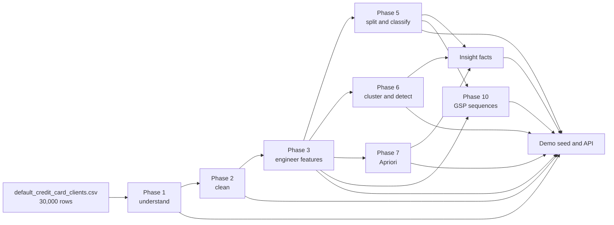

# Offline mining pipeline

CreditMiner uses an artifact-first pipeline. Run all commands from `backend/`. Each main reads the prior phase output and writes deterministic local evidence for the API, dashboard, and reports.

## Data flow



## Prerequisites

- Java 17.
- Maven with the project dependencies already cached for offline mode.
- `backend/data/raw/default_credit_card_clients.csv`.
- Weka 3.8.6 and the Maven dependencies declared by `backend/pom.xml`.

The raw file contains 30,000 records from UCI dataset 350. The pipeline runs locally. It does not require a database.

## Commands

Use `-o` to prevent Maven from accessing the network. The command succeeds only when the required plugins and dependencies are already in the local Maven cache.

### PowerShell

```powershell
Set-Location backend
mvn -o -q compile exec:java '-Dexec.mainClass=com.creditminer.pipeline.Phase1Report'
mvn -o -q compile exec:java '-Dexec.mainClass=com.creditminer.pipeline.Phase2Report'
mvn -o -q compile exec:java '-Dexec.mainClass=com.creditminer.pipeline.Phase3Report'
mvn -o -q compile exec:java '-Dexec.mainClass=com.creditminer.pipeline.Phase5Pipeline'
mvn -o -q compile exec:java '-Dexec.mainClass=com.creditminer.pipeline.Phase6Pipeline'
mvn -o -q compile exec:java '-Dexec.mainClass=com.creditminer.pipeline.Phase7Pipeline'
mvn -o -q compile exec:java '-Dexec.mainClass=com.creditminer.pipeline.InsightFactsReport'
mvn -o -q compile exec:java '-Dexec.mainClass=com.creditminer.pipeline.Phase10Pipeline'
```

### Bash

```bash
cd backend
mvn -o -q compile exec:java -Dexec.mainClass=com.creditminer.pipeline.Phase1Report
mvn -o -q compile exec:java -Dexec.mainClass=com.creditminer.pipeline.Phase2Report
mvn -o -q compile exec:java -Dexec.mainClass=com.creditminer.pipeline.Phase3Report
mvn -o -q compile exec:java -Dexec.mainClass=com.creditminer.pipeline.Phase5Pipeline
mvn -o -q compile exec:java -Dexec.mainClass=com.creditminer.pipeline.Phase6Pipeline
mvn -o -q compile exec:java -Dexec.mainClass=com.creditminer.pipeline.Phase7Pipeline
mvn -o -q compile exec:java -Dexec.mainClass=com.creditminer.pipeline.InsightFactsReport
mvn -o -q compile exec:java -Dexec.mainClass=com.creditminer.pipeline.Phase10Pipeline
```

Do not reorder the commands. A later phase can read artifacts from more than one earlier phase.

## Phase contracts

Paths below are relative to `backend/`.

| Order | Main class | Input | Processing | Output | Recorded run time |
|---:|---|---|---|---|---|
| 1 | `Phase1Report` | `data/raw/default_credit_card_clients.csv` | Map categorical codes to labels, rename columns, convert the UCI source to ARFF, and describe its columns | `data/processed/phase1_raw.arff`; `phase1_describe.json` | to be confirmed |
| 2 | `Phase2Report` | `phase1_raw.arff` | Remove 35 duplicate records, flag 1.5-IQR outliers, and retain negative bill values | `clean.arff`; `phase2_outliers.json`; `phase2_report.json` | to be confirmed |
| 3 | `Phase3Report` | `clean.arff` | Add seven engineered features | `enriched.arff`; `phase3_report.json` | to be confirmed |
| 4 | `Phase5Pipeline` | `enriched.arff` | Create the stratified seed-42 80/20 split, then evaluate ten Weka variants with 10-fold cross-validation and holdout prediction | `train.arff`; `test.arff`; `phase5_comparison.csv`; `phase5_evaluation.json`; `phase5_feature_importance.json`; method-named files in `models/`; `models/best.json` | Per-variant timing is recorded; no total is recorded |
| 5 | `Phase6Pipeline` | `enriched.arff`; `phase2_outliers.json` | Fit K-means with `k=2`, project PCA to two dimensions, and rank anomalies by centroid distance | `phase6_clusters.json`; `phase6_anomalies.json`; `phase6_pca_2d.json`; `phase6_elbow.json`; three K-means model files | to be confirmed |
| 6 | `Phase7Pipeline` | `enriched.arff` | Build the association matrix and run separate Apriori passes for default and non-default outcomes | `clean_assoc.arff`; `models/rules.json` | to be confirmed |
| 7 | `InsightFactsReport` | Enriched data plus Phase 5-7 evidence | Consolidate facts that support the insight cards | `phase9_insight_facts.json` | to be confirmed |
| 8 | `Phase10Pipeline` | `enriched.arff`; `train.arff`; `test.arff` | Build six-month repayment sequences, run exact-support GSP, and compare base features with fold-local sequence features | `sequences_default.arff`; `sequences_nondefault.arff`; `train_seq.arff`; `test_seq.arff`; `phase10_sequences.json` | Build 546 ms; default GSP 12,049 ms; non-default GSP 10,593 ms |

## Phase details

### Phase 1: understand the source

`Phase1Report` reads the source CSV and creates the raw ARFF contract. It also writes `phase1_describe.json` as generated evidence for `/api/mining-report`.

`GET /api/eda/describe` does not read that JSON file. It computes its response from the richest available data source in this order: `enriched.arff`, `clean.arff`, `phase1_raw.arff`, then the raw CSV.

### Phase 2: clean without hiding financial signals

The cleaning stage compares rows without the identifier, removes 35 duplicates, and leaves 29,965 rows. It flags outliers but does not delete them. It retains negative bill balances because they can represent credit balances.

### Phase 3: engineer model features

The seven derived features are:

- `UTILIZATION_1`
- `AVG_UTILIZATION`
- `PAY_RATIO`
- `MONTHS_DELAYED`
- `MAX_DELAY`
- `BILL_TREND`
- `RISK_TIER`

### Phase 5: compare classifiers

The phase first creates a stratified 80/20 split with seed 42. It writes 23,972 training rows to `train.arff` and 5,993 test rows to `test.arff`.

It then evaluates J48, RandomForest, NaiveBayes, and Logistic with baseline and SMOTE data. It also evaluates cost-sensitive J48 and RandomForest. The ten variants use 10-fold cross-validation.

The artifact records build, cross-validation, and holdout prediction time for each variant. In the current `phase5_evaluation.json`, build time ranges from 46 to 29,976 ms, cross-validation time ranges from 622 to 247,438 ms, and holdout prediction time ranges from 4 to 704 ms. These are component timings, not a complete phase wall time.

The selected model is RandomForest cost-sensitive. Its verified results are:

| Metric | Value |
|---|---:|
| Cross-validation F1 for `Default=Yes` | 0.5263 |
| Holdout F1 for `Default=Yes` | 0.5333 |
| Holdout ROC AUC | 0.777 |

Model filenames use the method and variant, from `DECISIONTREE.model` through `RANDOMFOREST_COST.model`. The inference service uses `RANDOMFOREST_COST.model` by default.

### Phase 6: describe structure and anomalies

The phase fits two customer clusters. It stores the cluster centroids and persona evidence. It also stores the two-dimensional PCA coordinates used by the EDA view. Anomaly scores are distances from the assigned centroid. The API combines this signal with the Phase 2 outlier flag.

### Phase 7: mine association rules

The default pass produced 42 rules. The non-default pass produced 50 rules. Rule consequents use `Default=Yes` or `Default=No`.

### Insight facts

`InsightFactsReport` joins class balance, bucket rates, cluster summaries, feature importance, and rule evidence. It writes `phase9_insight_facts.json`, which supports the insight content and report views.

### Phase 10: mine repayment sequences

The phase converts the ordered six-month histories to sequence itemsets. It runs GSP at support `0.10` for each outcome group and calculates support from exact client counts. The current processed artifact contains 2,037 frequent default-group patterns and 1,729 frequent non-default-group patterns.

The strongest default pattern is `<{PARTIAL}{LATE_2}>`. Its support is 48.2% for default clients and 14.1% for non-default clients. The feature experiment selects patterns inside each training fold to prevent evaluation leakage.

## Consumers

| Artifact | Main consumer |
|---|---|
| `phase1_describe.json` | Generated evidence in `/api/mining-report` |
| `enriched.arff`, `clean.arff`, `phase1_raw.arff`, raw CSV | `/api/eda/describe`, in richest-available order; later offline phases use the applicable ARFF files |
| `train.arff`, `test.arff` | Phase 10 evaluation and reproducible Phase 5 split evidence |
| `phase5_evaluation.json`, `phase5_feature_importance.json` | `/api/mining-report` and report pages |
| `phase6_clusters.json` | Demo seed, `/api/clusters`, and `/api/mining-report` |
| `phase6_anomalies.json`, `phase6_pca_2d.json` | `/api/anomalies`, `/api/eda/pca-2d`, and `/api/mining-report` |
| `models/rules.json` | Demo seed, `/api/rules`, and `/api/mining-report` |
| `phase9_insight_facts.json` | Insight evidence and `/api/mining-report` |
| `phase10_sequences.json` | `/api/sequences` and the sequence section of `/api/mining-report` |
| `models/RANDOMFOREST_COST.model` | `/api/predict` |

## Verification

After generation, check that each output exists and that the JSON files parse. Compare the row counts, split counts, selected model, and sequence counts with the verified values in this guide. Do not seed a PostgreSQL database as part of artifact verification.
